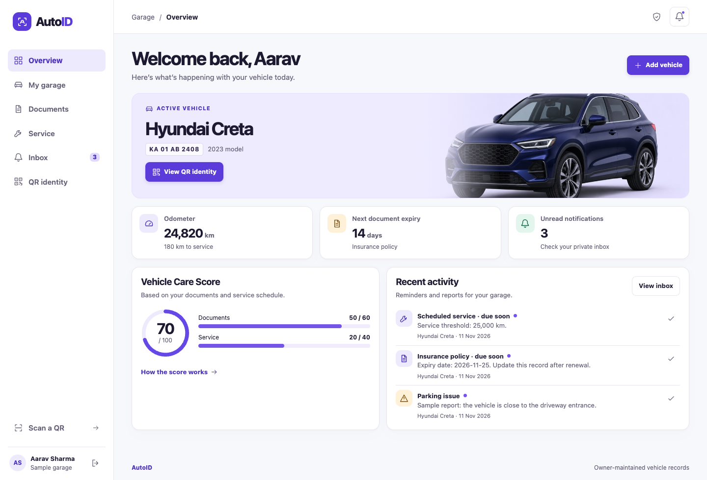

# AutoID

AutoID is a white-themed, local-first vehicle dashboard for a college final-year project. It combines QR-based vehicle identity, private PDF uploads, document and service reminders, and private reports from people who scan a sticker. The owner enters and maintains the records.

**Start here:** [Run on your Mac](#run-on-your-mac) · [Five-minute college demo](#five-minute-college-demo) · [College report](docs/COLLEGE-REPORT.md) · [Architecture](docs/ARCHITECTURE.md) · [Verification](docs/VERIFICATION.md)



## Run on your Mac

1. Extract the ZIP if you downloaded it. Open **Terminal**, type `cd ` (including the space), drag the **AutoID** folder into Terminal, then press Return.
2. Run `node -v`. This project was tested on Node.js **22.14.0** and requires **22.13.0 or later**. If Node is missing, install a supported LTS version from the [official Node.js download page](https://nodejs.org/en/download) and reopen Terminal.
3. Run these commands inside AutoID.

   ```sh
   npm ci
   cp -n .env.example .env
   npm start
   ```

4. Open [http://localhost:3000](http://localhost:3000) in Chrome or Safari. Click **Open sample garage** for a private sample with three documents and a service due in 180 km. Click **Create an account** when you want an account you can sign back into.
5. Leave Terminal open while using the app. Press **Control-C** in Terminal to stop it. Next time, open the same folder and run `npm start`.

The app automatically creates `data/autoid.sqlite`. The first install needs internet to fetch the dependencies. The running local app works offline. Local use has no app, database, or API fee.

### How the pieces connect

- Start `src/start.mjs` with `npm start`. It starts the Node server in `src/server.mjs`.
- Open the printed URL. The server serves `public/index.html`, the stylesheet, the dashboard script and the QR decoder. Opening the HTML directly from Finder bypasses the server.
- The browser calls the same server’s `/api/…` endpoints. The server reads and writes SQLite through `src/schema.sql`. The browser never receives a database connection.
- The server creates PNG stickers using `qrcode`. The browser decodes camera frames or images locally using `jsQR`. Local mode uses SQLite and needs no account with a hosting provider. Hosted mode uses Supabase PostgreSQL from a Vercel Function.

## Five-minute college demo

1. **Digital identity.** Open the sample garage. The Overview shows the sample vehicle and its score of **70/100**. Open **QR identity** and **Print sticker**. Save as PDF in the print dialog if you want a digital copy. The sticker contains a public link rather than any owner contact information.
2. **Smart care.** Open **Documents**, update the sample insurance expiry to more than 30 days away, then go to Overview. The score becomes **80**. Open **Service**, log a completed service at the current odometer, then return to Overview. The score becomes **100**. Open **How the score works** to show the calculation.
3. **Private assistance.** From **QR identity**, open the public profile in a new tab. Choose **Parking issue** or **Emergency concern** and submit a sample message. Back on the owner tab, open **Inbox** or use **Refresh** to see it. Mark the report as read.
4. **QR controls.** Copy the sticker URL before selecting **Replace QR**. Open the old URL to see it become unavailable. **Revoke QR** takes the current link offline. **Generate QR** creates a fresh one.
5. **Real camera flow.** Open **Scan a QR** and click **Start camera**. Allow browser camera access. Show the Mac webcam a printed sticker or a picture of that sticker on a second screen. The QR must point to the same AutoID address as the scanner. You can also save the QR image from the sticker page and select it under **Choose QR image**.

The inbox shows 25 events per page and has an emergency-only filter. The dashboard generates document and service reminders when it is opened or refreshed. Document reminders appear once per expiry date and status. Service reminders appear once per threshold and status. Existing entries remain as history after a renewal. The open inbox refreshes about every 20 seconds while visible and idle on the first page. Refresh manually to update sooner. Delivery is in-app, with no background emails, SMS, or emergency dispatch.

### Upload a PDF and protect your account

On your phone, sign in to the hosted owner dashboard. Open **Documents → Add or upload**, select the document type and choose a PDF from your phone’s file picker. Confirm the reference and expiry for a tracked type, then select **Save PDF**. Use **Download PDF**, **Replace PDF** or **Remove PDF** on the document row. Each vehicle can keep one current PDF per type, including one **Other document** attachment. Removing the file preserves the reference and expiry record. PDF uploads are limited to 2 MB each. Keep the previous copy yourself if you need it for your records.

Use the shield button in the dashboard header to sign out other devices or create a one-time recovery code. Create and save a code while you still have your password. Use **Reset with a recovery code** from the sign-in screen if you forget the password. Create a fresh code after recovery. Recovery is code-based and has no email delivery.

### Demonstrate a phone scan on the same Wi-Fi

Use sample data for this temporary HTTP demonstration. On the Mac, use **System Settings → Wi‑Fi → Details → TCP/IP** to find the Mac’s local IP address. Stop AutoID, then use the address in this command. Replace `192.168.1.20` with your Mac’s address.

```sh
HOST=0.0.0.0 PUBLIC_ORIGIN=http://192.168.1.20:3000 DEMO_MODE=true DATABASE_PATH=data/lan-demo.sqlite npm start
```

On the Mac, open that exact LAN URL, create a sample garage, and generate the QR there. On the phone, connect to the same Wi‑Fi and scan the sticker with the **phone’s built-in Camera app**. Open the link and submit a report. A campus guest network may isolate devices. If so, use the Mac webcam or a personal network that permits device-to-device access. For the **web page’s** camera scanner on a phone, serve AutoID over trusted HTTPS. Browsers allow camera access on HTTPS and localhost. [MDN camera documentation](https://developer.mozilla.org/en-US/docs/Web/API/MediaDevices/getUserMedia)

Press **Control-C** to end the LAN demo. A sticker links to the address configured when its QR was generated. Print a fresh sticker after moving to another address. Changing addresses alone does not rotate the QR token.

## Run tests

```sh
npm test
```

The automated tests use an isolated temporary database. They cover account access, validation, owner isolation, scoring, reminder deduplication, QR image decoding, private reports, revoked links and persisted data after a restart. Node 22 may print a SQLite experimental warning during startup.

## Upload the source to GitHub

1. Create an empty GitHub repository named `autoid` under your account. Start with a **Private** repository if you want to control who can see your submission. Leave GitHub’s initialization boxes unchecked.
2. In Terminal, inside AutoID, run the following. Replace `YOUR-USERNAME` with your GitHub username.

   ```sh
   git init -b main
   git add .
   git status --short
   git commit -m "Add AutoID final-year project"
   git remote add origin https://github.com/YOUR-USERNAME/autoid.git
   git push -u origin main
   ```

3. Check `git status --short` before committing. Source, docs, screenshots, `package-lock.json`, `.gitignore` and `.env.example` belong in GitHub. Keep `.env`, `node_modules/`, `data/` and all SQLite files local. GitHub Desktop also supports **Add Existing Repository → Publish repository** after you initialize and commit the folder.
4. If Git asks for your identity, configure your name and email using [GitHub’s Git setup guide](https://docs.github.com/en/get-started/git-basics/set-up-git). For a private repository, invite your examiner if they need access. [GitHub guide to pushing local code](https://docs.github.com/en/migrations/importing-source-code/using-the-command-line-to-import-source-code/adding-locally-hosted-code-to-github)

## Host on Vercel and Supabase

Follow the [Vercel and Supabase setup guide](docs/HOSTING.md). Vercel runs the website and API. Supabase holds accounts, vehicle records, PDF attachments, sessions and reports. Your Mac can be off once deployment is working. The local SQLite database stays local and hosted accounts start fresh.

## Common issues

- **Wrong address or write requests return 403** · Open exactly `PUBLIC_ORIGIN` as configured in `.env`. Restart after edits.
- **Port already in use** · Change both `PORT` and the port in `PUBLIC_ORIGIN`, then restart.
- **Camera blocked** · Allow camera permission in your browser and macOS **Privacy & Security → Camera**. Use localhost on the Mac or trusted HTTPS. QR image upload is available in the scanner.
- **Phone opens localhost** · Generate the sticker using the LAN demo address or the deployed HTTPS address.
- **Saved QR goes to an unavailable page** · The owner may have revoked or replaced it. Print or share the current sticker.
- **Forgot demo sign-in** · The sample account is a disposable session. Use **Open sample garage** again for a fresh demo. For your own account, keep your password in a password manager.

## Project files

```text
AutoID/
├── api/                    Vercel server entry point
├── supabase/               Hosted PostgreSQL schema
├── vercel.json             Hosted routing configuration
├── public/                 Browser screens, styles and vehicle illustration
├── src/                    Startup, HTTP API, SQLite schema and scoring
├── test/                   Automated score and HTTP tests
├── docs/                   College report, architecture and screenshots
├── .env.example            Copy to .env to configure your local run
├── .gitignore              Excludes secrets and runtime files
├── package.json            Startup/test commands and dependencies
├── package-lock.json       Reproducible npm installation
└── README.md               Setup, demonstration and deployment
```
# auto-id
# auto-id
