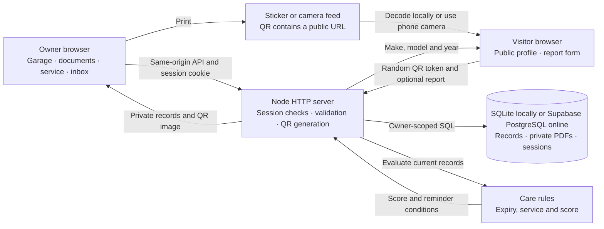
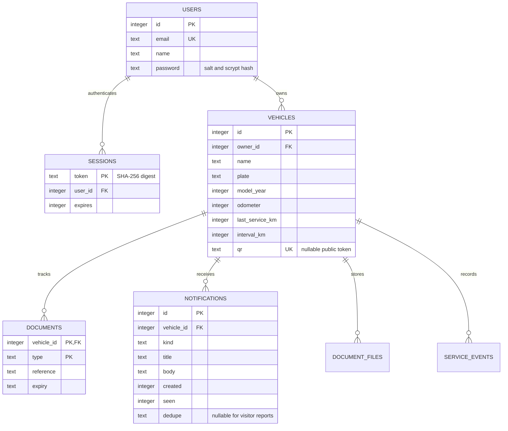

# AutoID architecture

## Data model

## Main flows

- **Owner** → register or sign in → session cookie → owner-scoped dashboard or mutation. Account email is normalized and unique. The same registration plate can appear in different owners’ private garages.
- **Sticker** → QR PNG encodes `PUBLIC_ORIGIN/p/<token>` → public API resolves the current token and returns only name and model year. Updating the database value retires the old URL.
- **Report** → visitor chooses parking or emergency → server validates token, category and message, then inserts an unread inbox entry → only the associated owner can read it or change its read state.
- **Care** → dashboard evaluates current owner records using UTC dates and kilometres → returns score components and inserts new reminder events if required. SQLite enforces event uniqueness per vehicle and condition.

## Hosted request path

GitHub supplies the code to Vercel. The Vercel Node function handles page requests and the same-origin API. It connects over TLS to the Supabase transaction pooler. SQLite is used for the Mac demonstration. Private attachments are stored as binary data with their vehicle and type, and download requests run the same owner check as uploads. Reports use database-backed limits so the counters carry across separate function instances.

## API map

- `GET /api/config` returns demo availability. `POST /api/register`, `/api/login`, `/api/demo` and `/api/logout` manage entry and exit.
- `GET /api/dashboard` returns private vehicles, care evaluations, unread count and recent notifications. `POST /api/vehicles` registers an owner vehicle.
- `GET /api/vehicles/:id/qr.png` renders the sticker code. `POST /api/vehicles/:id/qr`, `/care` and `/documents` change owner records.
- `POST /api/notifications/:id` and `/api/notifications/all` mark owner messages as read.
- `GET /api/inbox` returns paginated, optionally emergency-only history. Owner-only `GET` and `POST /api/vehicles/:id/files/:type` download, upload, replace or remove a PDF.
- `POST /api/sessions/revoke-others`, `/api/sessions/recovery-code` and `/api/recover` support device revocation and one-time password recovery.
- `GET /api/p/:token` returns a public profile. `POST /api/p/:token/report` sends a report.

Write routes require the configured origin. JSON inputs have size and field bounds. All user-controlled SQL values use placeholders. User-facing content is escaped before being inserted into HTML.
