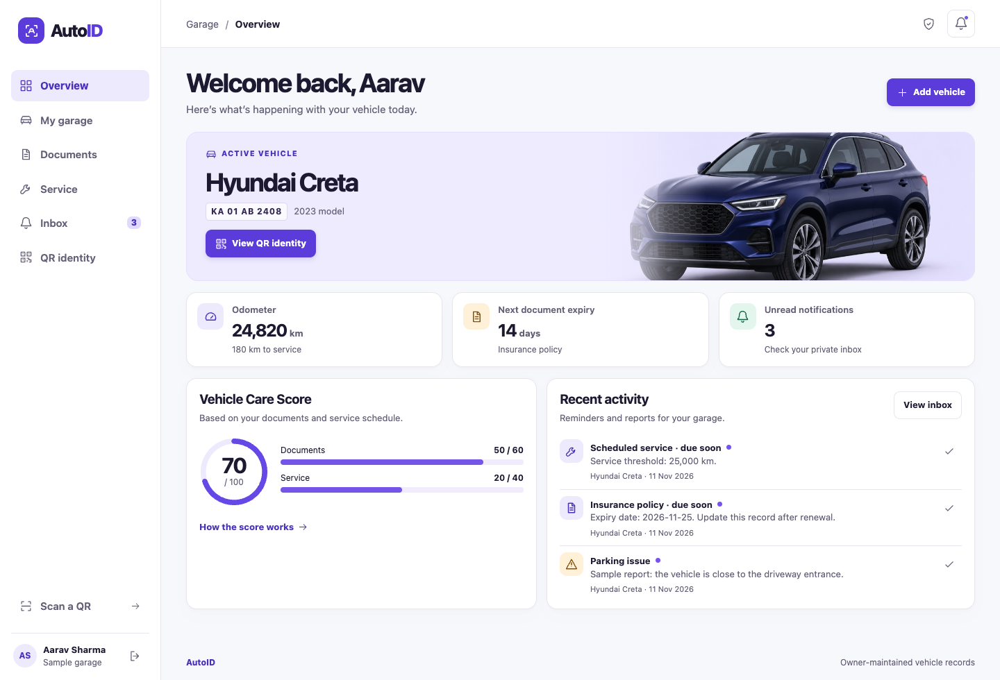

# Final-year project report

**Student:** [Your name]  
**Roll number:** [Your roll number]  
**Programme and department:** [Your programme and department]  
**Institution:** [Your college]  
**Project guide:** [Guide’s name]  
**Academic year:** [Academic year]

## Abstract

A vehicle owner may keep registration and insurance information in different places, track servicing separately and be difficult to reach when the vehicle blocks an entrance. AutoID combines three workflows in a local-first web application. The owner registers a vehicle and prints a QR sticker with a random public identifier. Visitors can scan the sticker, view the vehicle’s make, model and year, and send a private parking or emergency report. The owner maintains document reference numbers, expiry dates and mileage. Deterministic rules produce reminders and an explainable score from zero to 100. Node.js serves the browser interface and the API, while SQLite locally or PostgreSQL online persists records and sessions. Tests exercise owner isolation, QR decoding, reminder thresholds and restart persistence. AutoID uses owner-entered data for planning and private communication.

## 1. Problem statement and objectives

Vehicle documents expire on different dates and service intervals depend on kilometres driven. A static contact sticker can reveal a phone number to every passer-by. A QR sticker with a revocable link provides a way to report a problem while the owner controls the public identity.

The project has four objectives.

1. Create a distinct printable vehicle QR code with a minimal public profile.
2. Give owners a single place to maintain document and service records.
3. Generate explainable reminders and scores from the owner’s entries.
4. Deliver visitor reports privately and demonstrate authorization boundaries with repeatable tests.

The system supports multiple vehicles per account. It records document references, expiry dates and owner-only PDF attachments. Email and SMS delivery, government verification, sensor readings and emergency dispatch are outside the implemented scope.

## 2. Requirements and feasibility

**Actors.** A vehicle owner registers an account and manages private records. A visitor opens a valid QR link and may send a report without an account. A project evaluator can start a seeded sample garage or create a separate account.

**Functional requirements.** Owners can register vehicles, update records and mileage, log a service, print a sticker, replace or revoke its QR and mark notifications as read. Visitors can scan with the browser camera, upload a QR image, paste a QR URL or open a sticker with a phone’s camera. Parking and emergency reports are written to the owner’s inbox.

**Quality requirements.** The interface adapts to small screens and supports labelled controls and keyboard navigation. Database constraints, input bounds and ownership checks protect state. A sample garage enables a repeatable demonstration without personal details. The local installation needs Node.js, npm and a browser. The app uses SQLite and open-source npm packages with no recurring software cost for local operation.

## 3. System architecture and data model

AutoID uses a same-origin browser interface and HTTP API. The browser handles forms, rendering and camera decoding. The server authenticates requests, evaluates rules, generates stickers and writes durable records. The diagram shows the public and private paths.

```text
 Owner dashboard ── session cookie ──┐
      │                               ▼
      │ print                  Node.js HTTP API ─── SQLite
      ▼                               │             Users · sessions
 QR sticker ── scan ── Visitor ───────┘             Vehicles · documents
                        public token                Notifications
                               │
                         Private report
```

The owner dashboard sends a session cookie with private requests. The visitor path uses the public token to find a current vehicle identity. The server stores a report against that vehicle. A later authenticated inbox request retrieves it through the owner relationship.

A user owns many vehicles and sessions. Each vehicle has zero or one active public QR token, up to three document records and many notifications. Document type and vehicle ID form a composite key. Notification events may carry a deduplication key. The server uses foreign keys, unique constraints and bound SQL parameters. See [Architecture](ARCHITECTURE.md) for the complete diagrams and API map.

## 4. Implementation

### Digital identity

The server generates a 192-bit random token when registering a vehicle. It embeds that token in an AutoID URL and renders a PNG with a quiet border for printing. Browser camera frames and uploaded QR images are decoded locally. The public endpoint returns only the vehicle’s make, model and year. Revocation clears the current token. Replacement assigns a fresh one, so the previous public profile and report endpoint become unavailable.

### Smart vehicle care

Owners maintain the registration, insurance and emissions records. Each tracked record stores a reference and expiry date. Owners can upload a private PDF from their phone and replace or remove it. A separate Other document attachment does not contribute points. The service threshold is the last service odometer plus the selected service interval. The server subtracts the current odometer to calculate remaining kilometres. A service completion updates the last service odometer and moves the threshold.

On opening or refreshing the dashboard, the server evaluates the current records. A document produces a reminder when it has 30 or fewer days left, and an expired reminder once its date has passed. Service produces a near-due reminder with 1–500 km left, and a due reminder at zero or below. Stable deduplication keys prevent repeated refreshes from creating duplicate events.

### Private assistance

A visitor with a current link selects a report type and enters a short message. The API validates the category and message, checks that the QR is active and applies request limits. The owner receives a timestamped unread inbox entry. The public form advises visitors to contact emergency services directly when there is immediate danger.

## 5. Score algorithm

The score sums **three document checks worth 20 points each** and **one service check worth 40 points**.

- **Documents.** Each earns 20 points if expiry is more than 30 days away, 10 from the expiry date through 30 days remaining and 0 if expired or missing. Date comparisons use UTC calendar dates.
- **Service.** More than 500 km remaining earns 40 points, 1–500 km earns 20 and zero or fewer earns 0.
- **Sample calculation.** Registration 20 + insurance 10 + emissions 20 + service 20 = **70/100**. Renewing the insurance to more than 30 days raises the score to 80. Logging service at the current odometer raises it to 100.

The dashboard shows each contribution and explains the thresholds. The score represents readiness based on recorded documents and mileage. Its accuracy depends on the information entered by the owner.

## 6. Privacy, security and failure handling

Passwords are salted and hashed with scrypt. The server stores a SHA-256 digest of the random session token. Session cookies are HttpOnly and SameSite=Lax, with Secure enabled for HTTPS. Sessions expire after seven days and are invalidated on sign-out. Private requests scope SQL queries to the authenticated owner. The server checks the origin for writes, bounds JSON input, validates dates and mileage, and serves a restrictive content security policy. The UI escapes displayed user input.

A public profile excludes plates, account details, private references and inbox history. The public link functions while its random token remains active. Visitor reports are unverified messages. Rate limits use database-backed counters. Parking and emergency reports have separate IP and vehicle allowances. The database is stored on local disk and should be kept in a private data directory.

The UI displays actionable errors for invalid input, expired sessions, network failures, camera permissions, unreadable QR images and unavailable QR links. The photo upload and pasted-link options provide camera alternatives.

## 7. Testing and results

`npm test` reported **10 passed and 0 failed** on Node.js 22.14.0. The suite uses a separate temporary database and controlled dates. It checks scoring boundaries, registration, authentication, invalid data, cross-origin writes, access across owners, deduplicated reminders, both report types, QR revocation, rotation and persistence after a restart.

The Chrome walkthrough verified the sample dashboard, document renewal, service completion, QR generation, mobile layouts, sticker print styling, camera decoding using a simulated video feed, photo decoding, public reporting and private inbox updates. Physical camera, phone, print and hosting checks can be rehearsed using the README.



## 8. Deployment, limitations and future work

The recommended college demonstration runs on a Mac. GitHub can store the source and documentation. A public deployment requires HTTPS, a Node process and persistent storage. The project includes a Vercel deployment entry point, a Supabase PostgreSQL schema and a separate same-Wi-Fi demonstration. SQLite data, environment settings and dependencies are excluded from Git.

Current reminders are evaluated when the dashboard loads. Reports arrive in the app and appear when the owner opens or refreshes the inbox. The app uses manual odometer readings, a limited public profile. Future work could add user-controlled notification delivery, verified accounts, data export, accessibility testing across devices and a multi-instance deployment design.

## 9. Conclusion

AutoID implements a complete local workflow linking a revocable vehicle QR code, owner-maintained care records and private reports. The sample garage demonstrates the three functions together. Automated tests and a browser walkthrough provide evidence for the rules, authorization checks and main interaction paths.

## References

- [Node.js SQLite documentation](https://nodejs.org/api/sqlite.html)
- [MDN MediaDevices.getUserMedia](https://developer.mozilla.org/en-US/docs/Web/API/MediaDevices/getUserMedia)
- [QRCode package source](https://github.com/soldair/node-qrcode)
- [jsQR package source](https://github.com/cozmo/jsQR)
- [GitHub Pages publishing documentation](https://docs.github.com/en/pages/getting-started-with-github-pages/creating-a-github-pages-site)
